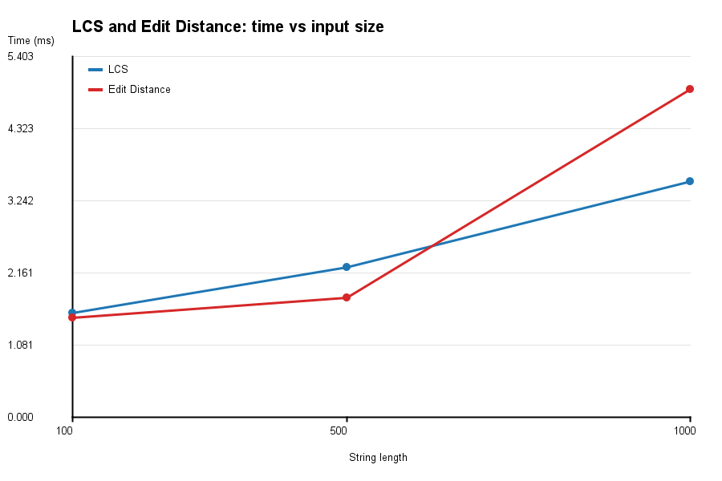
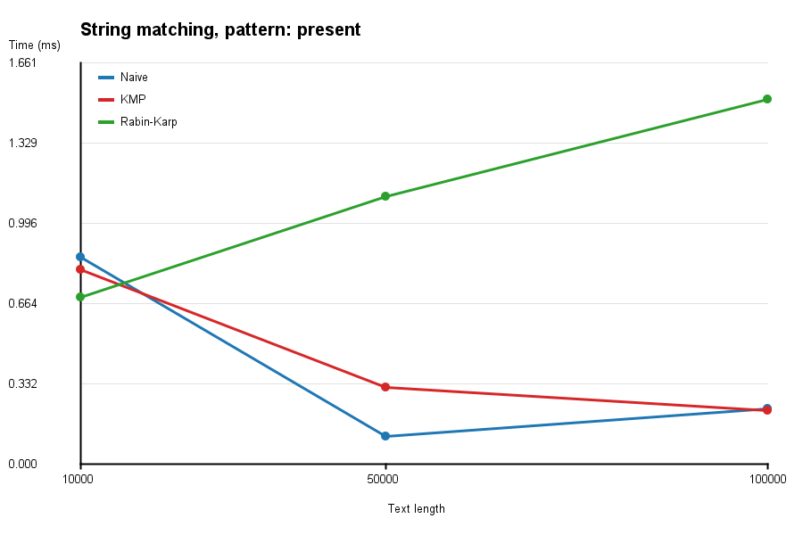
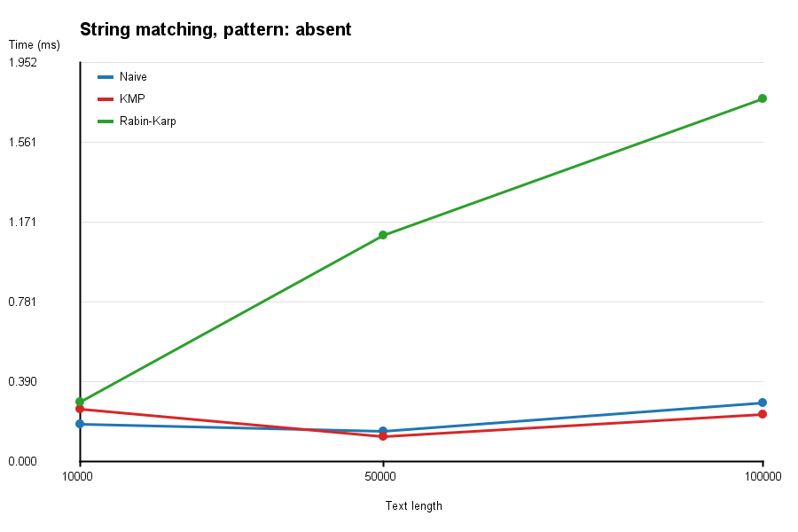
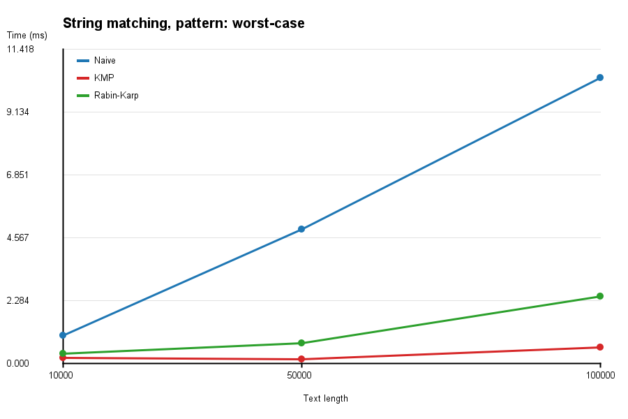
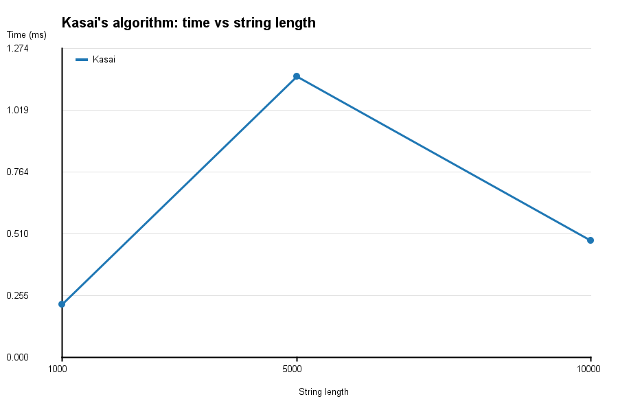

# Assignment 4 - Text Analysis: Dynamic Programming and String Algorithms

Java application that implements and compares algorithms for text analysis:

* **Part A** - dynamic programming: Longest Common Subsequence (LCS) and Edit Distance
* **Part B** - string matching: Naive, Knuth-Morris-Pratt (KMP) and Rabin-Karp
* **Part C** - Kasai's algorithm for the LCP array

All algorithms are written by me with plain Java. No external libraries and no library
methods for searching or sorting-based algorithms are used. The only standard-library
helpers are `ArrayList`, `Random`, `Arrays.sort` (only to build a simple suffix array
for the tests), `System.nanoTime()` and `java.awt` / `ImageIO` (only to draw the plots).

## 1. Problem description and algorithm overview

| Algorithm | What it solves |
|---|---|
| LCS | Length of the longest subsequence that appears in both strings (characters keep their order, but do not have to be next to each other). |
| Edit Distance | Minimum number of insertions, deletions and substitutions needed to turn string `a` into string `b`. |
| Naive matching | Checks the pattern at every position of the text. Used as a baseline. |
| KMP | Builds the LPS (prefix) table of the pattern, so after a mismatch the text pointer never moves back. |
| Rabin-Karp | Compares hashes of the pattern and of the current text window (rolling hash). Only if the hashes are equal, the characters are compared. |
| Kasai | Builds the LCP array in linear time from a string and its suffix array. |

## How to build and run

The project needs only a JDK (Java 17 or newer). Run all commands from the root folder of the repository.

Linux / macOS:

```bash
javac -d out $(find src -name "*.java")
```

Windows (PowerShell):

```powershell
javac -d out (Get-ChildItem -Recurse -Filter *.java src).FullName
```

Windows (cmd):

```bat
dir /s /b src\*.java > sources.txt
javac -d out @sources.txt
```

Run all tests:

```bash
java -cp out tests.RunAllTests
```

Run all experiments (creates tables and plots in the `results` folder):

```bash
java -cp out experiments.Main
```

### Repository structure

```
src/
  algorithms/   LCS, EditDistance, NaiveSearch, KMP, RabinKarp, SuffixArrayBuilder, Kasai
  util/         RandomStrings, Timer, Report, Plot
  experiments/  DpBenchmark, MatchingBenchmark, KasaiBenchmark, Main
  tests/        TestUtil, DpTests, MatchingTests, KasaiTests, RunAllTests
results/        csv tables, markdown tables and png plots created by experiments.Main
```

## 2. Implementation decisions and assumptions

* **Alphabet.** All random strings use the same alphabet: lowercase English letters `a-z` (26 characters).
* **Random seed.** Every string is generated with a fixed seed (`RandomStrings.generate(length, seed)`),
  so the experiments can be repeated with exactly the same inputs.
* **Empty pattern.** If the pattern is empty, Naive, KMP and Rabin-Karp all return an **empty list**
  (no occurrences). The same happens when the pattern is longer than the text.
* **Overlapping matches** are all reported, for example pattern `aa` in text `aaaa` gives `[0, 1, 2]`.
* **LCS and Edit Distance** use the full `(n+1) x (m+1)` table, as in the textbook recurrence.
  Only the length / distance is returned, the subsequence itself is not restored.
* **Rabin-Karp.** Base = 256, modulus = 1,000,000,007 (prime). When hashes are equal, the characters are
  always compared, so the result is always correct. There is a second method `search(text, pattern, mod)`
  where the modulus can be changed. The tests use `mod = 7` to produce many collisions on purpose.
* **Kasai.** `lcp[i]` is the length of the longest common prefix of the suffixes `sa[i]` and `sa[i-1]`,
  and `lcp[0] = 0`. The suffix array comes from `SuffixArrayBuilder`, which simply sorts all suffixes
  (slow, but allowed by the assignment and good enough for the strings of length up to 10,000).
* **Operation counts.** Each string matching class has a public static counter `comparisons`
  (Rabin-Karp also has `spuriousHits`). The same is done in Kasai. For KMP the counter includes comparisons made while building the LPS table.

## 3. Complexity analysis

Notation: `n`, `m` - lengths of the two strings for DP (`n` = text length and `m` = pattern length for string matching).
For Kasai `n` is the length of the string.

| Algorithm | Main operation / recurrence | Best case | Worst case | Auxiliary space | Why |
|---|---|---|---|---|---|
| LCS | `L[i][j] = L[i-1][j-1] + 1` if `a[i]==b[j]`, else `max(L[i-1][j], L[i][j-1])` | O(n*m) | O(n*m) | O(n*m) | We always fill the whole table, each cell costs O(1). Only the last row is needed to compute the length, so O(min(n,m)) is possible, but my version keeps the full table. |
| Edit Distance | `D[i][j] = D[i-1][j-1]` if `a[i]==b[j]`, else `1 + min(D[i-1][j], D[i][j-1], D[i-1][j-1])` | O(n*m) | O(n*m) | O(n*m) | Same table size and O(1) work per cell. |
| Naive matching | Compare pattern with the text at every shift | O(n) - the first character of the pattern never matches | O(n*m) - for example text `aaaa...a`, pattern `aaa...ab` | O(1) (without the result list) | There are `n-m+1` shifts, and each shift can compare up to `m` characters. |
| KMP | LPS table; on mismatch `j = lps[j-1]` | O(n + m) | O(n + m) | O(m) | LPS is built in O(m). In the search the text pointer `i` never goes back, and every mismatch that decreases `j` is paid by an earlier increase of `j`, so at most about `2n` comparisons are made. |
| Rabin-Karp | Rolling hash `h = (h - t[i]*BASE^(m-1)) * BASE + t[i+m]` (mod prime) | O(n + m) | O(n*m) | O(1) (without the result list) | Hash of every window is updated in O(1). If hashes are equal we compare the characters (O(m)). With a good hash false matches are rare, so the *expected* time is O(n + m). The worst case happens when many windows have the same hash as the pattern, or when the pattern really occurs at many places (text `aaaa`, pattern `aaaa`). |
| Kasai (LCP) | Compare suffix `i` with its predecessor in the suffix array, start from `h - 1` | O(n) | O(n) | O(n) | Arrays `rank` and `lcp` have size `n`. `h` grows only by comparing characters and decreases by at most 1 per step, `h <= n`, so the total number of increases is at most `2n`. |

The suffix array is an input of Kasai's algorithm. My simple builder (sorting suffixes) is **not** part of this
analysis and is not used inside the timed region.

### Why the recurrences are correct

**LCS.** `L[i][j]` is the LCS length of the first `i` characters of `a` and the first `j` characters of `b`.
Base case: if one prefix is empty, the LCS is empty, so `L[i][0] = L[0][j] = 0`.
If `a[i] == b[j]`, we can always match these two last characters (matching them is never worse than skipping them),
so `L[i][j] = L[i-1][j-1] + 1`. If they are different, at least one of them is not in the LCS, so we throw away
the last character of `a` or of `b` and take the better result: `max(L[i-1][j], L[i][j-1])`.
Smaller problems repeat many times, so the table saves the answers (overlapping subproblems).

**Edit Distance.** `D[i][j]` is the minimum number of operations to turn the first `i` characters of `a` into the first `j` characters of `b`.
Base case: to get from `i` characters to an empty string we need `i` deletions, and from an empty string to `j` characters we need `j` insertions.
For the last characters there are only four possibilities: they are equal (cost 0, go to `D[i-1][j-1]`),
or we substitute (`D[i-1][j-1] + 1`), delete `a[i]` (`D[i-1][j] + 1`) or insert `b[j]` (`D[i][j-1] + 1`).
We take the minimum, so the table always contains the best answer.

### How KMP avoids repeated comparisons

`lps[k]` is the length of the longest proper prefix of `pattern[0..k]` that is also its suffix.
When `pattern[0..j-1]` was matched and then a mismatch happens, the last `lps[j-1]` matched characters are
already the beginning of the pattern. So we continue with `j = lps[j-1]` and we do not compare these characters again.
The text index `i` is never decreased. The Naive algorithm in the same situation moves one position forward and starts again from `j = 0`.

### How Rabin-Karp handles hash collisions

Two different strings can have the same hash (a collision). So when `patternHash == windowHash`, the algorithm does not
trust the hash and compares the characters one by one. If they are different, it is a *spurious hit* (counted in `spuriousHits`)
and the algorithm just continues. This way the result is always correct, only the running time can become worse.
In the tests `mod = 7` creates a lot of collisions and the results are still equal to the other algorithms.

### What the LCP array represents

If the suffixes of a string are sorted alphabetically (this order is the suffix array `sa`), then `lcp[i]` tells how many
first characters the `i`-th suffix shares with the previous suffix in this order. Example for `banana`:

| i | sa[i] | suffix | lcp[i] |
|---|---|---|---|
| 0 | 5 | a | 0 |
| 1 | 3 | ana | 1 |
| 2 | 1 | anana | 3 |
| 3 | 0 | banana | 0 |
| 4 | 4 | na | 0 |
| 5 | 2 | nana | 2 |

The idea of Kasai: if suffix `i` has common prefix of length `h` with its predecessor, then suffix `i+1` has a common
prefix of length at least `h-1` with its own predecessor (we only removed the first character). So we do not start from zero.
The LCP array is useful for example to find the longest repeated substring (the maximum value in `lcp`).

### Theoretical complexity vs measured time

The table above is the **theoretical** complexity: it says how the number of operations grows when the input grows, and it ignores constants.
The **measured** time in section 6 depends on the computer, on the Java JIT compiler and on the constants.
For small inputs the measured time can be noisy, so I also record the number of character comparisons, which does not depend on the computer.

## 4. Testing strategy and results

Tests are plain Java programs (no JUnit). Each test compares the expected and the actual result and prints `[PASS]` or `[FAIL]`.
Run them with `java -cp out tests.RunAllTests`. If a test fails the program finishes with exit code 1.

| Algorithm | Tested cases |
|---|---|
| LCS | identical strings, completely different strings, first / second / both strings empty, classic example `AGGTAB` / `GXTXAYB` (answer 4) |
| Edit Distance | identical strings, first / second string empty, substitution (`cat` -> `cut`), insertion (`cat` -> `cart`), deletion (`cart` -> `cat`), classic example `kitten` / `sitting` (answer 3) |
| String matching | pattern at the beginning, in the middle and at the end; multiple occurrences; overlapping occurrences; pattern absent; pattern longer than the text; pattern equal to the text; empty pattern; empty text; classic KMP example; checks of the LPS table |
| Kasai | `banana`: suffix array `[5, 3, 1, 0, 4, 2]` and LCP `[0, 1, 3, 0, 0, 2]` checked by hand; `aaaa`; 20 random strings compared with a slow brute-force LCP |

For **every** string matching test, Naive, KMP and Rabin-Karp must return exactly the same list of indices as the expected list
(Rabin-Karp is also tested with `mod = 7` to force hash collisions).

Result: all tests pass (`Passed: 82, failed: 0`).

## 5. Experimental setup

* **Computer:** Intel Core 5 120U, 16 GB RAM, Windows
* **Java version:** OpenJDK 27 (build 27+35-2325)
* **Alphabet:** lowercase letters `a-z` (26 characters), same for all experiments.
* **Random seed:** fixed. Seeds: 1 and 2 for the two strings of LCS / Edit Distance, 3 for the text in string matching, 4 for Kasai.
* **Input sizes** (fixed by the assignment):

| Experiment | Input sizes |
|---|---|
| LCS | two strings of length 100, 500, 1000 |
| Edit Distance | two strings of length 100, 500, 1000 (the same strings as for LCS) |
| String matching | text length 10,000, 50,000, 100,000, pattern length 50 |
| Kasai | string length 1,000, 5,000, 10,000 |

* **Patterns for string matching** (the same text and the same pattern are used for Naive, KMP and Rabin-Karp):
    * `present` - a substring of the text (taken from the middle of the text), so it occurs in the text;
    * `absent` - the same substring, but the last character is replaced with `#`. The character `#` is not in the alphabet, so the pattern cannot occur;
    * `worst-case` (extra experiment) - text `aaa...a` and pattern `aaa...ab`. This input is bad for the Naive algorithm.
* **Timing:** `System.nanoTime()`. Every experiment is run 5 times and the average is reported (in milliseconds).
  One extra warm-up run is made before the 5 measured runs and is not counted, because the first run of Java code is slower (JIT compiler).
* **What is inside the timed region:** only the call of the algorithm. Input generation, the suffix array building for Kasai,
  printing to the console and writing files are **outside** of the timed region.
* **Operation counts:** the number of character comparisons is counted in one additional run (not one of the 5 timed runs).
  The counters are plain `static long` increments inside the algorithms, so they add a very small cost to the measured time of all algorithms.
  For Rabin-Karp the number of spurious hits (equal hashes, different strings) is also counted.

## 6. Experimental results

> The numbers below were produced by `java -cp out experiments.Main` on my computer (see section 5).
> The raw data is in the `results` folder (`*.csv` and `*.md`).

### 6.1 LCS and Edit Distance

| Length | LCS time (ms) | Edit Distance time (ms) | LCS length | Edit distance | Table cells |
|---|---|---|---|---|---|
| 100 | 1.571 | 1.492 | 32 | 90 | 10000 |
| 500 | 2.252 | 1.797 | 155 | 445 | 250000 |
| 1000 | 3.534 | 4.912 | 317 | 882 | 1000000 |



### 6.2 String matching

Columns "comparisons" are numbers of character comparisons, "RK spurious hits" is the number of equal hashes with different strings.

| Case | Text length | Matches | Naive (ms) | KMP (ms) | Rabin-Karp (ms) | Naive comparisons | KMP comparisons | RK comparisons | RK spurious hits |
|---|---|---|---|---|---|---|---|---|---|
| present | 10000 | 1 | 0.857 | 0.807 | 0.692 | 10396 | 10435 | 50 | 0 |
| absent | 10000 | 0 | 0.184 | 0.260 | 0.292 | 10396 | 10436 | 0 | 0 |
| worst-case | 10000 | 0 | 1.194 | 0.176 | 0.205 | 497550 | 20048 | 0 | 0 |
| present | 50000 | 1 | 0.117 | 0.320 | 1.111 | 52024 | 51987 | 50 | 0 |
| absent | 50000 | 0 | 0.151 | 0.124 | 1.109 | 52024 | 51988 | 0 | 0 |
| worst-case | 50000 | 0 | 4.575 | 0.192 | 0.761 | 2497550 | 100048 | 0 | 0 |
| present | 100000 | 1 | 0.231 | 0.222 | 1.510 | 104022 | 103913 | 50 | 0 |
| absent | 100000 | 0 | 0.289 | 0.231 | 1.774 | 104022 | 103914 | 0 | 0 |
| worst-case | 100000 | 0 | 12.300 | 0.476 | 1.577 | 4997550 | 200048 | 0 | 0 |

Pattern present in the text:



Pattern absent from the text:



Extra worst-case input for Naive (`aaa...a` and `aaa...ab`):



### 6.3 Kasai's algorithm

| String length | Kasai time (ms) | Character comparisons | Max LCP value |
|---|---|---|---|
| 1000 | 0.138 | 1972 | 4 |
| 5000 | 1.092 | 9970 | 4 |
| 10000 | 1.252 | 19970 | 5 |



## 7. Discussion: theory vs experiment

**LCS and Edit Distance.** Both algorithms are O(n*m), and here n = m. When the length grows from 100 to 500, the table has
25 times more cells (10,000 -> 250,000), and from 500 to 1,000 it has 4 times more (250,000 -> 1,000,000).
The measured time does not show this clearly: LCS became only 1.4 times slower (1.571 -> 2.252 ms) and then 1.6 times
(-> 3.534 ms), Edit Distance 1.2 times and 2.7 times. The reason is that for length 100 the whole job is only 10,000 cells,
so the 1.5 ms is mostly fixed overhead (array allocation, JIT compiler, timer): it is about 150 ns per cell. For length 1,000
the time is only 3.5-4.9 ns per cell, which is the real cost of one cell. So the quadratic growth is confirmed by the number
of table cells, but the measured time for such small inputs is dominated by overhead and looks flatter than the theory.
LCS and Edit Distance have similar times, because both fill the same table with O(1) work per cell. The small differences
(Edit Distance is faster at 500 and slower at 1,000) are inside the measurement noise.

**String matching on random text.** The numbers of comparisons are linear in the text length. For n = 10,000 / 50,000 / 100,000
Naive makes 10,396 / 52,024 / 104,022 comparisons, which is about 1.04 * n, and KMP makes almost the same
(10,435 / 51,987 / 103,913, this includes about 50 comparisons for the LPS table). Naive is not worse than KMP here,
because the alphabet has 26 letters and almost every shift fails on the first character, so one shift costs about 1.04
comparisons. Rabin-Karp makes only 50 character comparisons when the pattern is present (it checks the one real match) and 0 when
the pattern is absent. There were 0 spurious hits in all experiments, which agrees with the theory: the expected number is about
`n / 1,000,000,007`, that is about 0.0001 for n = 100,000.

Fewer comparisons do not mean less time. For n = 100,000 Rabin-Karp was about 7 times slower than KMP (1.510 ms vs 0.222 ms with
the pattern present, 1.774 ms vs 0.231 ms with the pattern absent), because it updates the hash for every character
(two `%` operations on `long`), while Naive and KMP only compare two characters. For a short pattern and a big alphabet the
hash costs more than it saves.

The times on random text are very small (mostly less than 2 ms) and noisy. For example, Naive with the pattern present takes
0.857 ms for n = 10,000, but only 0.117 ms for n = 50,000, although the text is 5 times longer. A bigger input cannot be faster, so
this is JIT warm-up: the first test (n = 10,000) is measured while the code is not compiled well yet. That is why I do not use
these times to say which of Naive and KMP is faster. The comparison counts show that they do the same amount of work.

**String matching, worst case for Naive** (`aaa...a` and `aaa...ab`, pattern length 50). Here the theory is clearly visible.
Naive makes 497,550 / 2,497,550 / 4,997,550 comparisons. For n = 100,000 this is exactly `(n - m + 1) * m = 99,951 * 50`, so Naive is
O(n*m). KMP makes 20,048 / 100,048 / 200,048 comparisons, about `2n`. For n = 100,000 Naive does 25 times more comparisons than KMP,
and the time is also about 26 times bigger (12.300 ms vs 0.476 ms). Naive time grows 10.3 times (1.194 -> 12.300 ms) when the text
grows 10 times, which is linear in `n` for a fixed `m`. Rabin-Karp makes 0 comparisons, because the hash of the window never equals the
hash of the pattern, and its time (0.205 / 0.761 / 1.577 ms) is linear and almost the same as in the "absent" case, because the hash update costs
the same for any text. I did not measure the worst case of Rabin-Karp itself (many collisions or many real matches), but the collision
handling is checked in the tests with `mod = 7`.

**Kasai.** The number of comparisons is 1,972 / 9,970 / 19,970 for n = 1,000 / 5,000 / 10,000, that is 1.97n, 1.99n and 2.00n. This confirms
the linear bound and the `2n` estimate from the analysis. On a random text with 26 letters the longest common prefix is short
(max LCP 4, 4 and 5), so the value of `h` stays small. The time (0.138 / 1.092 / 1.252 ms) is not exactly linear
(5 times longer string -> 7.9 times more time, and 2 times longer -> 1.15 times), which is again noise and JIT at the level of one millisecond.
The comparison counter is much cleaner than the time.

**Theory vs measured time.** The operation counts follow the theory almost exactly: the number of table cells (n*m), `(n - m + 1) * m`
comparisons for Naive in the worst case, about `n` for KMP and `2n` in the worst case, about `2n` for Kasai. The measured time is less stable,
because almost all measurements are shorter than 2 ms and are affected by JIT compilation, garbage collection and other programs.
The measurements also have limits: only 5 runs after 1 warm-up run, one computer and no confidence intervals. Bigger inputs or more
warm-up runs would give smoother curves, but the assignment fixes the sizes, so I use the operation counts as the main evidence and the times as a supporting result.

## 8. Conclusion

* **LCS / Edit Distance:** dynamic programming gives the exact answer in O(n*m) time. The price is memory: the full table needs O(n*m) memory
  (it can be reduced to O(min(n, m)) if we only need the length).
* **Naive:** the simplest code and no extra memory, and it is fast on random text, but the worst case is O(n*m).
* **KMP:** guaranteed O(n + m) time for any input, the price is an extra array of size `m` and a more complicated code.
* **Rabin-Karp:** expected O(n + m) and constant extra memory, easy to extend to many patterns, but the worst case is O(n*m) and the
  result depends on a good hash (collisions must be checked by comparing characters).
* **Kasai:** builds the LCP array in O(n) time and O(n) memory if the suffix array is already known. The slow part in practice is building the suffix array itself.